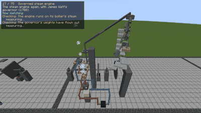
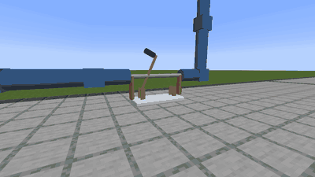
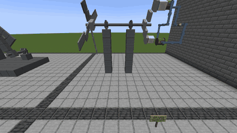
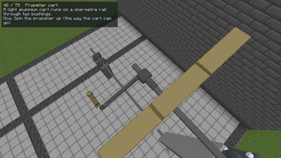
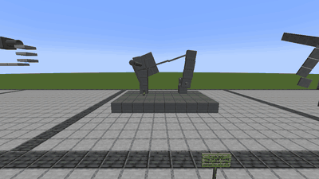
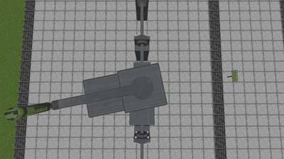

# Emergence: Engineering Universe

A Minecraft (NeoForge 1.21.1) mod that is a scientifically grounded engineering sandbox: you build machines
from primitive physical parts — shafts, bearings, magnets, coils, wires, resistors, gears, electrodes and
electrolytes — and they behave according to simulated physics. Each part fills one block (a scale model,
1 block = 6.25 cm); with precision tweezers in the off-hand you can also build at true scale, 16 cells per
block. There is no "generator block": a generator *emerges* when magnets turn past
coils.

## In action

Recorded in the demo world by its automated tour (`tools/make_gifs.py`). Nothing here is scripted: each machine is
parts, and what it does is computed from their physics.

| | |
|---|---|
|  |  |
| **Governed steam engine.** A boiler, cam-worked valves and a piston, with Watt's flyball governor driven through bevel gears. Its weights fly out and close the throttle through a plug valve, so the engine holds its own speed. | **Flyball governor.** The same governor on a DC motor. As the motor speeds up the weights slide out against their springs, and through link bars they turn a rheostat that reins it in. |
|  |  |
| **Wind turbine.** The world's wind on twisted blades (lift and drag by blade element) turns a generator built from magnets and coils. | **Propeller cart.** A hand-cranked propeller's thrust drives a light cart along its rail. |
|  |  |
| **Four-bar linkage.** Rigid link bars pinned between turning bodies: the crank's rotation becomes the rocker's swing. | **Unbalanced rotor.** An off-centre mass on a spinning shaft shakes its sprung platform, hardest near resonance. |

* **Play the demo:** `./gradlew generateDemoWorld` then `./gradlew runDemoClient`
  (or open *Singleplayer → Emergence Demo*). In any world, `/emergence demo` builds the exhibit gallery.
  To watch it being built, part by part: `./gradlew runWatchDemoBuild`.
* **Tests:** `./gradlew coreTest` (physics, no Minecraft) · `./gradlew runGameTestServer` (in-world).
* **Docs:** ARCHITECTURE · PHYSICS_MODELS · MATERIAL_DATABASE · VALIDATION · PERFORMANCE ·
  KNOWN_LIMITATIONS · ROADMAP · DEVELOPMENT_LOG · NEXT_STEPS.
